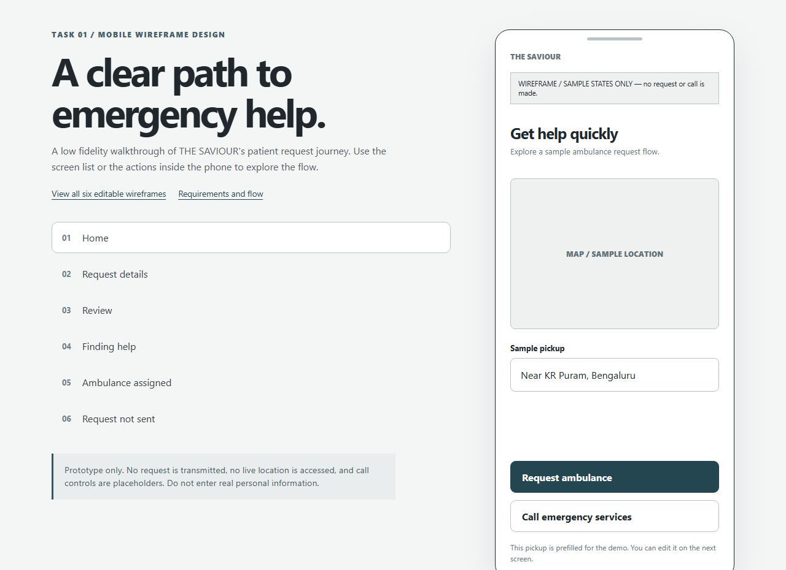
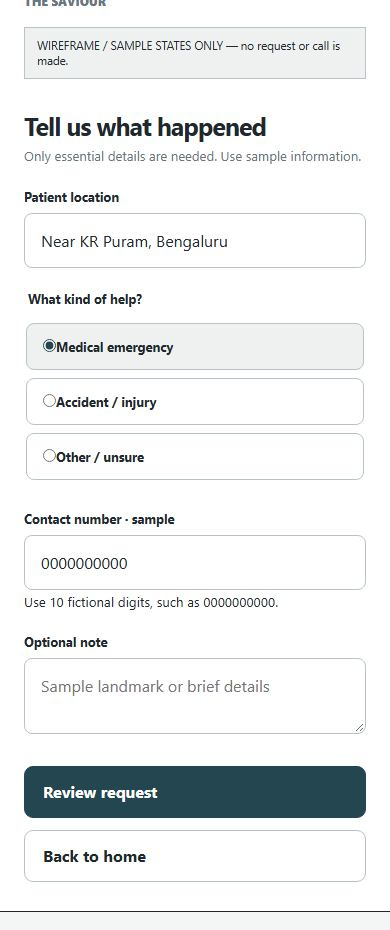
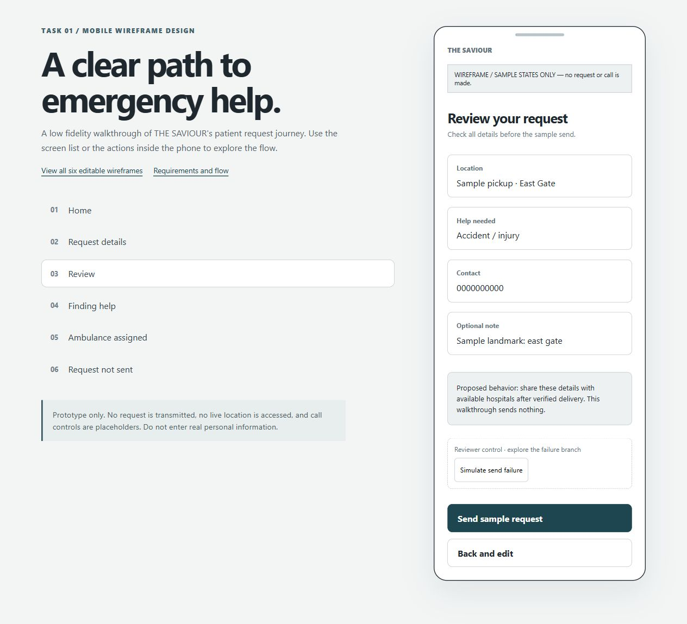
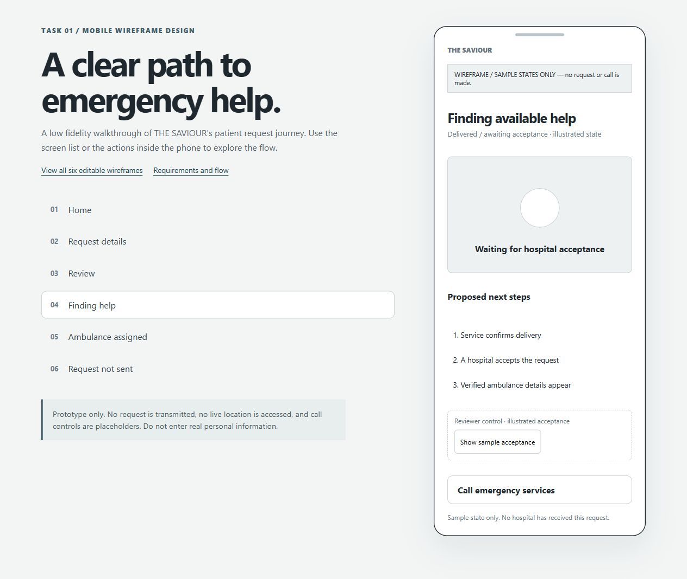
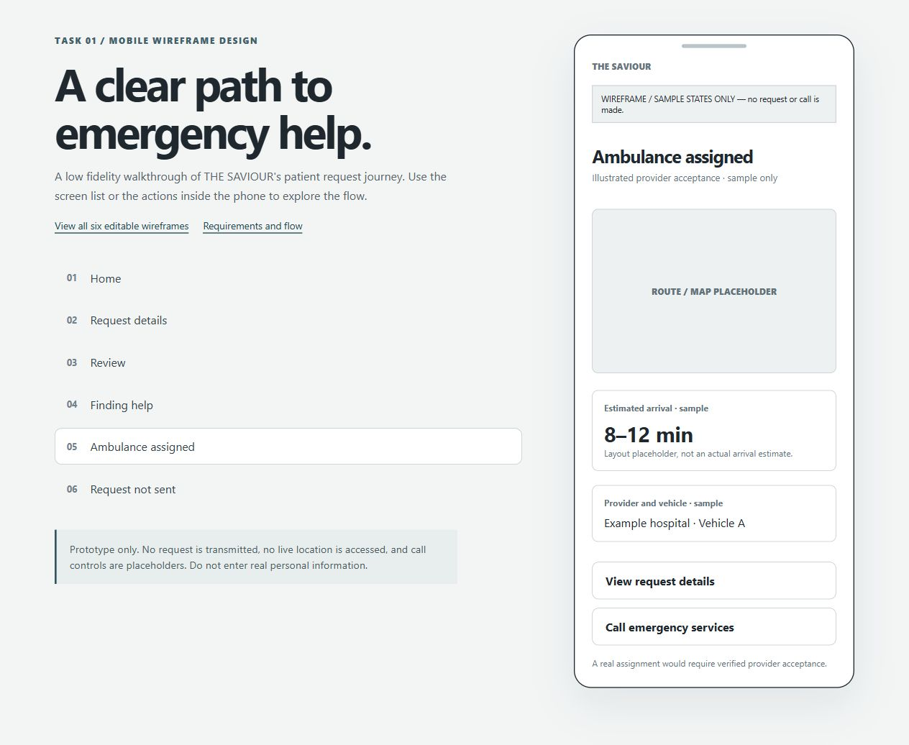
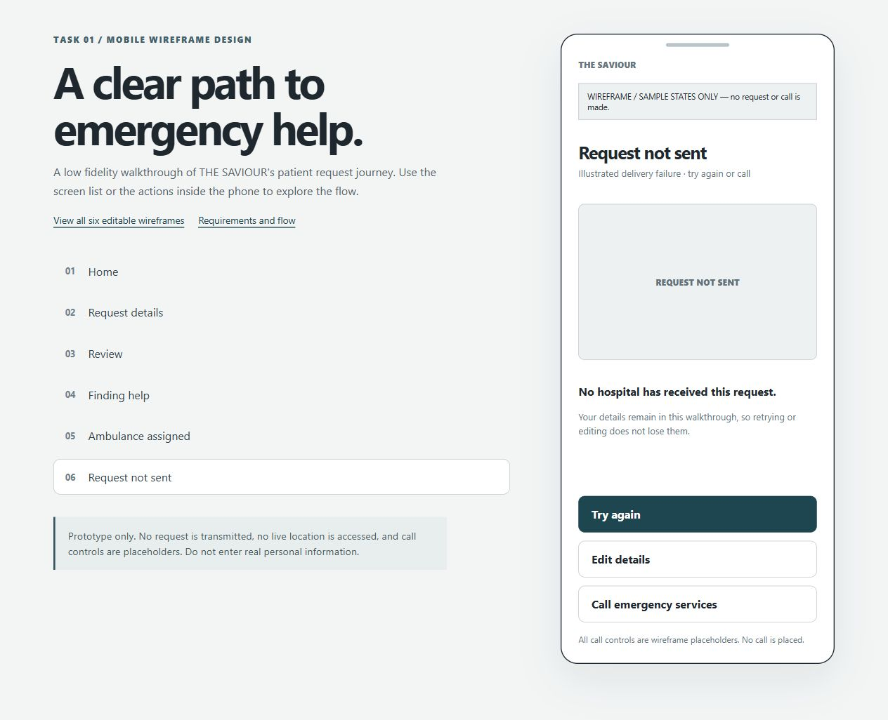

# Task 01 — Re-evaluation against the complete brief

**Review finalized:** 16 November 2026. Browser captures were made during the 15–16 November review.  
**Verdict:** The revised submission meets the stated low fidelity wireframe scope. This is an internal design and implementation review, not client approval or a claim of perfect accessibility.

Both uploaded copies of the 13-page PDF were reread. They contain the same task wording. Pages 4–5 cover originality, organization, professional delivery and completion of any four tasks; page 6 defines Task 1; page 12 lists evaluation and submission items. Pages 1–3 and 13 explain the program and certification rather than additional wireframe features.

## Every required workflow step

| Step from PDF page 6 | Status | Evidence |
| --- | --- | --- |
| 1. Define application requirements | Met | README requirements R1–R7 and screen purposes. |
| 2. Create wireframes for key screens | Met | Six simple grayscale screens in `wireframes.svg` and the walkthrough. |
| 3. Design navigation flow between screens | Met | README flow map, forward/edit/retry transitions and screen selector. |
| 4. Review usability and accessibility | Met as an inspection | Review accuracy, retention, labels, keyboard focus, controls and mobile reflow checked; limits below. |
| 5. Present the wireframe design | Met | Editable board, board screenshot, screen captures, organized source and rationale. |

No screen count, production backend, particular app category, participant interview or specific design-file format is mandated by Task 1. Figma and Adobe XD appear as examples in the program introduction, not as an exclusive submission format.

## All evaluation criteria from page 12

| Criterion | Finding |
| --- | --- |
| Task Completion | Required design artifacts and five workflow steps are represented. |
| Code Quality | Separate readable HTML/CSS/JS, escaped displayed inputs, native controls, no dependencies; `node --check app.js` passes. |
| Website Responsiveness | Desktop capture and verified 375 px layout; no horizontal page overflow in that mobile check. The fixed SVG is a presentation board, not a responsive webpage. |
| User Interface Design | Consistent low fidelity structure, primary actions, layout placeholders and explicit state labels. |
| Creativity & Implementation | Emergency handoff and failure recovery are worked through without pretending a real service exists. Original source and vector elements; no copied third-party product artwork. |
| Professional Presentation | Requirements, flow, editable board, six screenshots and clear limitations. |
| Project Functionality | Walkthrough controls, form review, editing, local retention, failure and sample assignment work within the intended design scope. |

## Findings corrected

| Finding before review | Correction |
| --- | --- |
| Optional note omitted from Review | Note now appears alongside the other entered details. |
| Screen replacement lost keyboard focus | New screen heading receives focus. |
| Back navigation did not retain unfinished changes | Draft values update while the form is edited. |
| No explicit back action on Details | Back to Home added. |
| Call alternatives appeared as inert cards | Buttons explain the wireframe call placeholder without making a call. |
| Provider, live-route and ETA copy could be misread | Permanent sample notice, placeholder labels and illustrated-state explanations. |
| Prior presentation depended on an unverified Figma reference | Added a complete editable SVG board and current browser evidence. |

## Captured walkthrough — all steps

1. **Home — healthy:** pickup placeholder and request/call actions are visible.  
   
2. **Details — healthy within wireframe scope:** location, category, contact and note are labelled.  
   
3. **Review — corrected:** all entered fields, including the note, appear with an edit path.  
   
4. **Finding help — healthy as an illustrated state:** waiting is distinct from acceptance.  
   
5. **Assigned — healthy as an illustrated state:** provider and arrival information are explicitly sample placeholders.  
   
6. **Failure — corrected:** no delivery is claimed; edit/retry retain details.  
   

## Submission and evidence limits

Source, screenshots and branch/folder are included. Video is optional. The initial Figma file could not be reread through the connector; use the verified SVG and HTML source. No real dispatch, real device field study, screen reader session, or participant test was performed. Those are not implied by the internal usability inspection.

Temporary Vercel sharing is not a dependable permanent submission artifact. Generating another public share link was blocked by automatic approval review after the audit resumed; no security setting was changed.

## Submission evidence refresh · 20 November 2026

The editable six-screen SVG and the walkthrough now both identify the prefilled sample pickup and explain that it can be edited on the next screen. The board also shows the 10-digit fictional contact hint.

The screenshots below were recaptured from the revised prototype. Earlier evidence files are historical.

- [01-home-desktop.jpg](screenshots/01-home-desktop.jpg)
- [02-details.jpg](screenshots/02-details.jpg)
- [07-mobile.jpg](screenshots/07-mobile.jpg)
- [08-wireframes-board.jpg](screenshots/08-wireframes-board.jpg)
