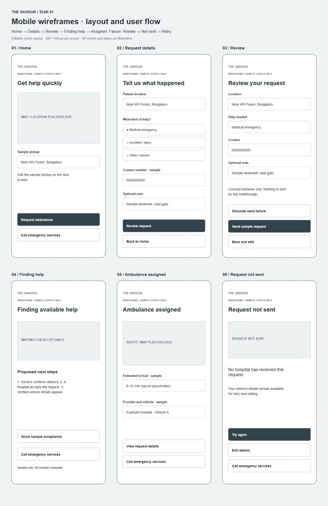
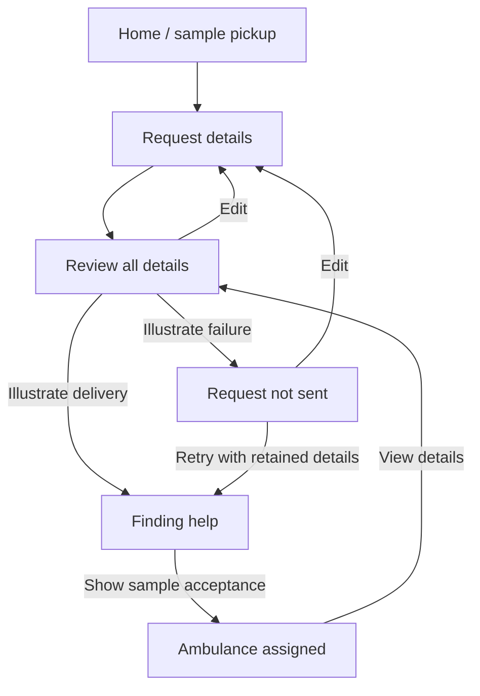

# Task 01 — Mobile app wireframe design

**Product:** THE SAVIOUR / patient request concept  
**Required outcome:** Low fidelity mobile wireframes focused on layout and user flow.  
**Submission:** [Editable six-screen board](wireframes.svg), [browser walkthrough](index.html), [review evidence](EVALUATION.md), and [screenshots](screenshots/).

## What the client asked for

The Auspify UI/UX task list, page 6, specifies five steps: define application requirements; create key wireframes; design navigation; review usability/accessibility; present the design. Page 12 asks for source and completed-task screenshots. A GitHub link is requested if available; video is optional.

This is a layout study. The brief does not ask Task 1 to integrate hospitals, provide a backend, or conduct a participant study. The browser walkthrough is supplementary evidence of the navigation.

## Requirements

| ID | Application requirement | Design evidence |
| --- | --- | --- |
| R1 | Let a patient or bystander check and correct the pickup before continuing. | Home shows the sample pickup; Details permits editing it. |
| R2 | Collect category and contact; make extra context optional. | Labelled form, radio group, optional note. |
| R3 | Review everything that would be sent, and allow correction. | Review includes location, category, contact and any optional note; Edit returns to retained details. |
| R4 | Distinguish delivered/waiting from provider acceptance. | Separate Finding help and Assigned wireframes. Both are explicitly illustrated states. |
| R5 | Show an undelivered outcome with retry and a call alternative. | Failure wireframe says no hospital received the request; retry and edit retain the draft. |
| R6 | Keep calling available without accidentally making a call during design review. | Labelled call buttons display an explicit placeholder message. |
| R7 | Support a review on desktop and mobile with keyboard-accessible controls. | Responsive presentation, semantic controls, focus indicators and focused screen headings. |

## Navigation

The numbered screen list is a **reviewer control** for visiting any wireframe. It is not proposed as patient-facing app navigation.

## Key screens and layouts

| Screen | Layout priority | Main transition |
| --- | --- | --- |
| 01 Home | Pickup/map placeholder, primary request, call alternative | Details |
| 02 Details | Location, emergency category, contact, optional note | Review or Home |
| 03 Review | All entered content, edit, primary send | Waiting or illustrated failure |
| 04 Finding help | Waiting state, next steps, call | Sample acceptance |
| 05 Assigned | Provider, vehicle and arrival placeholders | View details or call |
| 06 Failure | Explicit non-delivery, retained draft, retry, edit, call | Waiting or Details |

The editable SVG uses six 390 × 844 px artboards. The HTML demonstration allows content to grow and scroll rather than clipping long notes. Grayscale blocks and simple typography keep attention on structure.

## Usability and accessibility review

| Inspection | Result and limit |
| --- | --- |
| Review accuracy | Optional note was missing; fixed and verified in the browser. |
| Error recovery | Failure → Edit retained the category, location and optional note in the walkthrough. |
| Focus | Replacing screens formerly lost focus; it now moves to the new heading. |
| Controls | Native labelled inputs, a named radio group, visible keyboard focus, 52 px primary controls and at least 44 px scenario buttons. |
| Mobile | A 375 px viewport was verified with no horizontal document overflow; mobile presentation screenshot is included. |
| State clarity | Permanent sample notice plus per-state labels prevent the map, provider and arrival placeholders from implying live data. |
| Assistive technology | Labels and heading focus inspected. A real screen reader session and participant testing were not performed. |

No full WCAG certification or measured usability improvement is claimed.

## Run and inspect

Open `index.html` locally. The files have no runtime dependencies. Use fictitious information; nothing is transmitted or saved after reload. Run `node --check app.js` for a syntax check.

Read [EVALUATION.md](EVALUATION.md) for the criterion-by-criterion audit and evidence for all six steps of the demonstration.

The [initial Figma wireframes](https://www.figma.com/design/OoIJIHcTxCjIO37I3FHNom) are a historical companion. The Figma connector could not reread that file during this audit, so its current contents and permissions are **unverified**. The submitted SVG, browser source and new screenshots are the verified deliverables. The older `wireframes-overview.png` is an initial version, not the revised presentation.

## Submission package

- Source: `index.html`, `styles.css`, `app.js`, `wireframes.svg`.
- Screenshots: all six states, desktop/mobile presentation and the six-screen board in `screenshots/`.
- GitHub: branch `task/01-mobile-wireframes`, folder `task-01-mobile-wireframes/`.
- Demonstration video: optional; not recorded.
- Live Vercel preview: supplementary and access-protected; temporary share links expire. Submit the source and screenshots as durable evidence.

