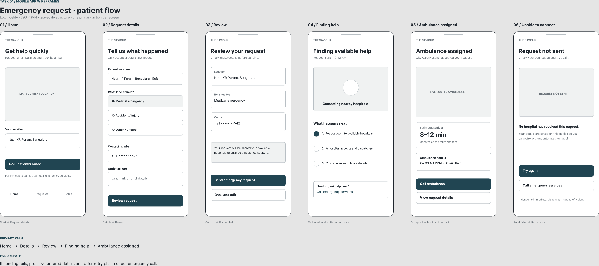
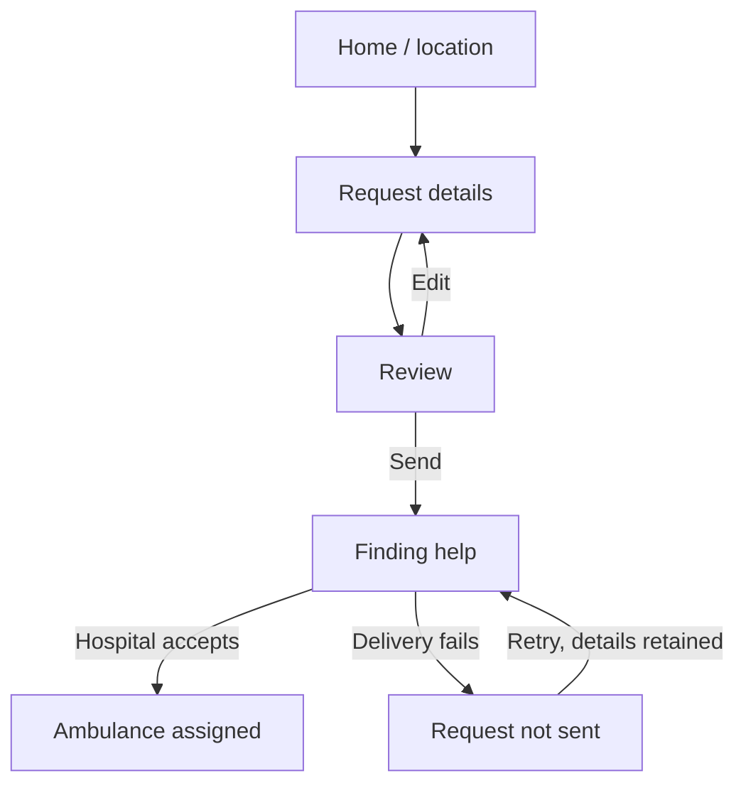

# Task 01 — Mobile app wireframes

**Product:** THE SAVIOUR · patient emergency request flow  
**Deliverable:** low fidelity mobile wireframes, navigation map, and a browser based walkthrough  
**Canvas:** 390 × 844 px

[Open the editable Figma wireframes](https://www.figma.com/design/OoIJIHcTxCjIO37I3FHNom)

## Problem and scope

In a stressful situation, a patient or bystander needs a short path to request an ambulance, see whether the request was actually sent, and know what to do if delivery fails. This flow covers the patient's side only. Hospital acceptance and traffic police coordination are separate product flows and are not implied by these screens.

### Requirements

1. Let the user check or correct the pickup location before sending.
2. Request only the emergency category, a contact method, and optional context.
3. Show a review step and a clear transition from unsent to sent.
4. Distinguish waiting for a hospital from an ambulance that has actually been assigned.
5. If delivery fails, explicitly say no hospital received the request and preserve the form details.
6. Keep a direct emergency calling alternative visible while waiting and after failure.

## Screen map

| Screen | Purpose | Main action | Next state |
| --- | --- | --- | --- |
| 01 Home | Confirm location and start | Request ambulance | 02 Details |
| 02 Details | Collect essential request information | Review request | 03 Review |
| 03 Review | Check information before sending | Send emergency request | 04 Finding help |
| 04 Finding help | Show request status and next steps | Wait, or call emergency services | 05 Assigned or 06 Failure |
| 05 Assigned | Show hospital, ambulance, and ETA | Call ambulance | Remains in tracking state |
| 06 Failure | State clearly that no request was delivered | Try again or call | 04 Finding help; calling needs production setup |

**Navigation:** `Home → Details → Review → Finding help → Assigned`; failed delivery opens `Failure → Retry`. Review offers a back path to edit the details. The browser walkthrough includes a state switch for the two possible outcomes; it does not contact a real hospital.

## Design decisions

- One prominent action per screen and direct labels reduce choices under stress.
- The review step prevents an accidental send while keeping the information brief.
- Delivery failure says explicitly that **no hospital received the request**. A retry retains the entered information.
- Emergency calling is available during the wait and failure states. The number must be configured and validated for deployment; the prototype deliberately does not invent one.
- ETA is an estimate, not a promise. The interface says it can change.
- Large controls, readable contrast, visible focus, and text status labels avoid relying on color alone.

### Usability and accessibility review

| Check | Review result |
| --- | --- |
| Primary action | One clear, 52 px high primary control on each action screen. |
| Form clarity | Location, emergency type, contact, and note have visible labels; note is optional. |
| Error recovery | Failure copy states that delivery did not occur; retry retains the entered details. |
| Status comprehension | Text distinguishes searching from assigned; status never relies on color alone. |
| Keyboard walkthrough | Native buttons and inputs expose focus; focus-visible styling is present in the HTML. |
| Screen reader | Semantic form labels and a named navigation region are present; a real screen reader test is still needed. |
| Device and network | Small-screen layout is included; real device, offline, and slow-network tests remain for implementation. |

## Run the walkthrough

Open `index.html` in a browser. No install or build step is required. The walkthrough is a local UI prototype with sample details; it is not an emergency service.

## Review checklist

- [x] Six key screens and primary navigation are mapped.
- [x] Send, wait, accepted, and failure states are distinct.
- [x] Form fields have labels and controls remain keyboard accessible.
- [x] Mobile viewport and desktop presentation were considered.
- [x] Overview screenshot is included for submission.
- [ ] Test the flow with real users, including a screen reader user, before treating usability as validated.
- [ ] Verify production emergency call routing, hospital availability, privacy, and data delivery before implementation.

