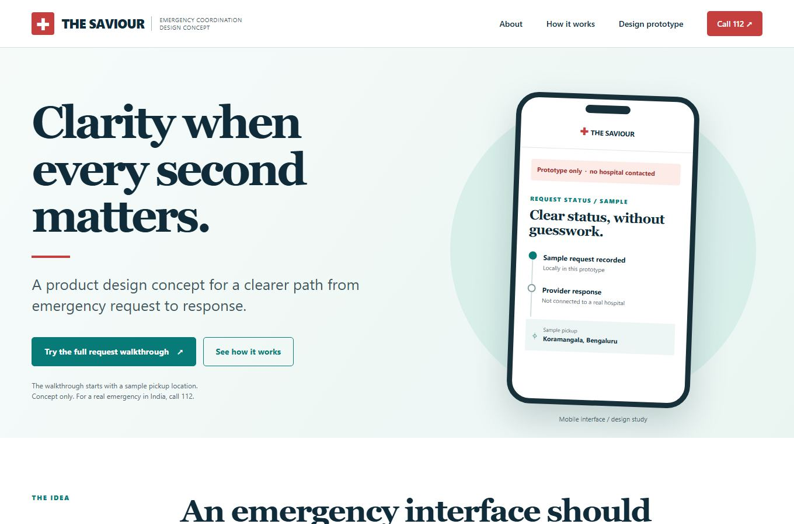
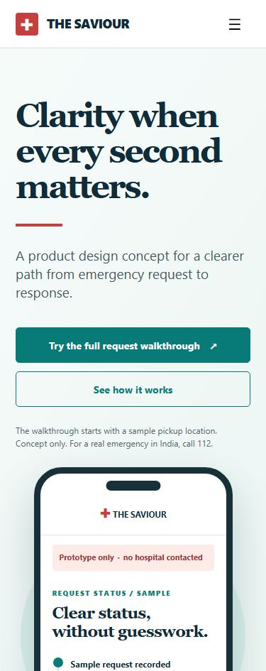
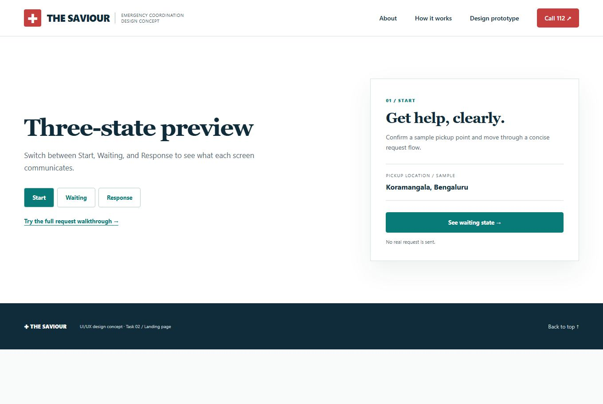
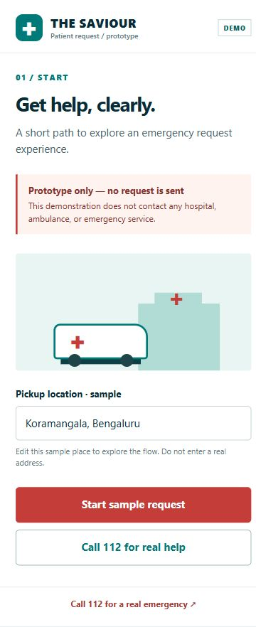

# Task 02 — Re-evaluation against the complete brief

**Review finalized:** 16 November 2026. Browser captures were made during the 15–16 November review.  
**Verdict:** The revised package meets the stated responsive landing-page design scope. Client approval, perfect visual quality and full accessibility conformance are not guaranteed by this review.

Both uploaded copies of the complete 13-page brief were reread. Task 2 is on page 7; page 12 supplies the general evaluation/submission criteria. The introduction mentions Figma and Adobe XD as tools but does not restrict the submission to a particular design-file format.

## Every workflow step from page 7

| Required step | Status | Evidence |
| --- | --- | --- |
| 1. Research design inspiration | Met as desk research | README reference/decision table: NHS 111 entry page, GOV.UK interface content, existing patient-flow structure. |
| 2. Create page layouts and sections | Met | Eight coherent page sections and desktop/mobile captures. |
| 3. Apply typography and color schemes | Met | DESIGN.md defines families, scale, palette, spacing and component treatment. |
| 4. Design call-to-action elements | Met | Hero preview link, steps link, bundled walkthrough and explicit calling link. |
| 5. Build a high fidelity mockup | Met in code | Complete rendered landing page at desktop, 375 px and 320 px widths. |

## All evaluation criteria from page 12

| Criterion | Finding |
| --- | --- |
| Task Completion | All five design steps have concrete evidence; this is a landing page, not a production emergency app. |
| Code Quality | Readable HTML/CSS/JS, small state model, no dependencies; main and bundled script syntax checks pass. |
| Website Responsiveness | Desktop and two mobile widths inspected. At 320 px, the document width did not exceed the viewport. |
| User Interface Design | Deliberate type hierarchy, consistent palette, single main CTA, readable phone composition, labelled controls. |
| Creativity & Implementation | Original coded composition and purposeful preview; no fabricated partners, endorsements or live metrics. |
| Professional Presentation | Design rationale, typography/color specification, complete source, desktop/mobile screenshots and clear project scope. |
| Project Functionality | Anchors, mobile menu, preview tabs, keyboard state changes and bundled walkthrough link verified. Calls were not placed. |

## Findings corrected

| Before | After |
| --- | --- |
| Required screenshots absent from the repository | Saved actual browser screenshots of the completed page and walkthrough. |
| Three tabs initially entered the Tab sequence | Only the selected tab has tabindex 0; inactive tabs are -1. |
| Advancing a preview removed the focused button and left focus on BODY | Replacement panel receives focus. |
| Escape left the mobile menu open | Menu now closes and returns focus to its button. |
| Visitor-facing link went to GitHub source | Link opens the bundled interactive walkthrough. |
| Phone caption overlapped its frame | Caption positioned below the composition; phone constrained to available width. |
| Sources and visual decisions were loosely described | Explicit reference/decision table and DESIGN.md added. |

## Captured journey — all important steps

1. **Entry and product explanation — healthy:** page purpose, hero CTA and concept disclosure visible.  
   
2. **Mobile reading and navigation — healthy at tested widths:** content stacks, menu opens/closes, no horizontal page overflow in the 320 px check.  
   
3. **Preview — corrected:** Start, Waiting and Response states work; one keyboard tab stop; arrow/Home/End behavior and focus restoration checked.  
   
4. **Full walkthrough destination — healthy:** local destination loads the mobile request prototype without relying on a source-code page.  
   

The 320 px full-page capture is also saved as `screenshots/03-mobile-320.jpg`.

## Evidence limits

The checks were internal browser observations, source inspection and syntax checks. A real screen reader session, physical-device testing, cross-browser matrix and participant study were not performed. No full WCAG compliance or conversion improvement is claimed.

Source, completed-page screenshots and the separate GitHub branch/folder fulfill the stated submission package. Video is optional. No Figma high fidelity file was created; the complete code and rendered mockup are the supplied editable implementation.

Vercel's protected URLs and expiring shares are supplementary. Creating another public share link was rejected by automatic approval review after this audit resumed. No authentication setting was changed; the repository and screenshots remain the durable evidence.

## Submission evidence refresh · 20 November 2026

The main call to action opens the full walkthrough and previews its starting point. The embedded preview is labeled as a separate three-state preview.

The screenshots below were recaptured from the revised prototype. Earlier evidence files are historical.

- [01-desktop.jpg](screenshots/01-desktop.jpg)
- [02-mobile-375.jpg](screenshots/02-mobile-375.jpg)
- [03-mobile-320.jpg](screenshots/03-mobile-320.jpg)
- [04-preview.jpg](screenshots/04-preview.jpg)
