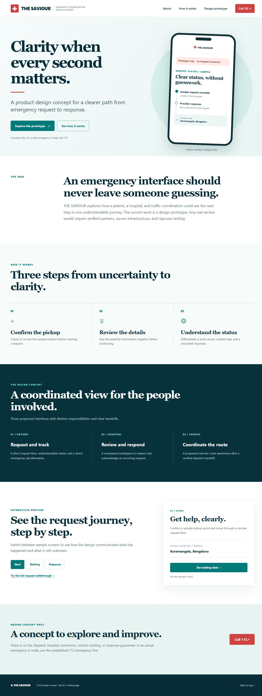

# Task 02 — Landing page UI design

**Product:** THE SAVIOUR, an emergency coordination design concept.  
**Required outcome:** A modern, responsive landing page with a high fidelity mockup.  
**Submission:** [Page source](index.html), [design system](DESIGN.md), [evaluation](EVALUATION.md), and [completed-page screenshots](screenshots/).

## What the client asked for

Page 7 of the Auspify UI/UX task list specifies inspiration research, page layout/sections, typography/color, calls to action and a high fidelity mockup. Page 12 asks for source and completed-task screenshots. A video is optional. A production emergency backend is not part of this landing-page task.

The page introduces the concept, explains the proposed journey and encourages exploration. Its primary action opens the on-page preview. A second link opens a bundled mobile walkthrough, so it works from a downloaded source submission.

## Inspiration research and decisions

| Reference reviewed | Observation | Decision |
| --- | --- | --- |
| [NHS 111 online](https://111.nhs.uk/) | Its entry page uses a clear purpose, help choices and a separate explanation of its scope. | Lead with a short product purpose and an obvious action; explain limitations near the preview. NHS 111 is an England service and is not the service proposed here. |
| [GOV.UK interface-writing guidance](https://www.gov.uk/service-manual/design/writing-for-user-interfaces) | It favors concise, descriptive labels and language that works under stress. | Use specific CTA labels and short sequential explanations. |
| Existing Task 1 structure | Location → details → review → distinct outcome states. | Reuse the journey in the phone composition and three-state preview. |

A custom generated visual concept established the initial art direction. The implemented phone, text, controls, logo mark and layout are code-native; generated imagery is not used as a completed-page screenshot. This research supports design choices; it is not participant research or proof of improved emergency outcomes.

## Page layout

1. Header: product identity, section navigation and call alternative.
2. Hero: one principal message, primary CTA, supporting CTA and phone composition.
3. Idea: purpose and proposed coordination scope.
4. How it works: three ordered steps.
5. Roles: patient, hospital and traffic responsibilities.
6. Interactive preview: start, local waiting and simulated response.
7. Closing: scope disclosure and emergency call alternative.
8. Footer: task identity and return-to-top link.

See [DESIGN.md](DESIGN.md) for type scale, palette, components and breakpoints.

## Run locally

Open `index.html`. No build or dependencies are needed. Keep `styles.css`, `app.js` and `prototype/` next to it. The bundled walkthrough is a snapshot of the existing Task 3 implementation, included only so the landing-page CTA has an accessible destination; Task 3 remains a separate project/branch.

Run `node --check app.js` and `node --check prototype/app.js`.

## Verification and submission

The audit checked desktop, 375 px and 320 px layouts, navigation, preview tabs, keyboard state changes and the bundled walkthrough destination. See [EVALUATION.md](EVALUATION.md) for observed results, fixes and limits.

Submit this folder's source, screenshots and GitHub branch `task/02-landing-page`. A video is optional and was not recorded. The Vercel preview is supplementary; temporary access links expire. No Figma high fidelity file or real-user usability study is claimed. The brief does not mandate either for Task 2.

