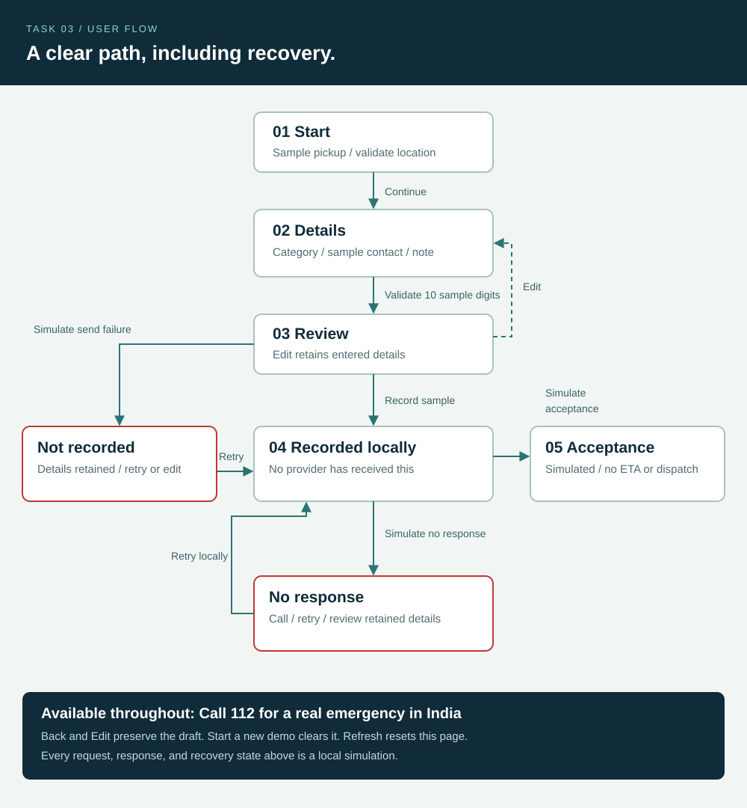

# Design rationale - Task 03

## Problem and intended user

A person exploring an emergency request should understand what information is needed, what happened after continuing, and how to recover when help is unconfirmed. The working hypothesis is that short steps, explicit status, and a persistent real-help exit reduce ambiguity. This is a design hypothesis, not a finding from interviews.

The brief asks for flow diagrams, high-fidelity screens, interaction, navigation testing, and refinement. It does not specify a connected hospital backend or require a particular design-file format. The coded prototype and original SVG provide inspectable source for those deliverables.

## Screen inventory

| Screen | Main decision | Recovery or exit |
| --- | --- | --- |
| Start | Enter a sample pickup | Whitespace error with focused input; Call 112 |
| Details | Select category, sample contact, optional context | Contact error; Back retains unfinished draft |
| Review | Check details before recording | Edit details; choose failed-send scenario |
| Recorded locally | Understand that recording is not delivery | Simulate response or no response; restart |
| Acceptance | See an example response presentation | Explicitly no real acceptance, dispatch, or ETA; restart |
| Send failure | Understand that recording failed | Retained details; edit or retry; call link |
| No response | Understand that help is unconfirmed | Review retained details; retry locally; call link |

The diagram shows the main decisions and alternate paths. Back and Edit retain the draft throughout. Start a new demo clears it; refresh starts a new in-memory session. An unknown route returns to Start, and an unearned response route cannot display acceptance.

## Visual and interaction system

The navy presentation panel frames the desktop submission. On mobile, the app occupies the screen directly. A consistent header, spacing scale, input treatment, notice, summary row, action group, and timeline keep the seven screens related. Teal supports navigation and recorded states; red calls attention to important actions and unconfirmed outcomes. Wording, icons, and headings carry meaning alongside color.

Native inputs have visible labels, a numeric keyboard hint, descriptive help, and linked error feedback. Primary controls are at least 48 pixels tall. Screen changes focus the heading; errors focus the affected field. The skip link changes focus without changing the current screen. There is no required animation, external font download, location prompt, or automatic submission.

## Verified refinements

| Observed issue in the original | Change | Evidence |
| --- | --- | --- |
| Back discarded the unfinished category and note | Capture draft changes as entered; preserve Back and Edit | Browser draft and history checks; state regression test |
| Whitespace pickup silently blocked progression | Trim and validate; visible alert, invalid state, and focused field | `09-mobile-validation.jpg` |
| Navigation rendered twice for a button transition | Use one hash-change render path | Stable sequential browser walkthrough; source inspection |
| Only immediate send failure was explorable | Add a distinct no-response scenario and retained-detail recovery | `06-mobile-no-response.jpg` |
| Restart retained previous sample fields | Explicit restart resets the draft and response flags | Restart regression and browser checks |
| Skip link could be interpreted as a route | Intercept it to focus the current heading | Browser skip-link check |

## Validation boundaries

The walkthrough used fictitious locations and `0000000000`. No real call was placed, and no participant study or provider integration was performed. These checks support assignment-level prototype acceptance; they do not establish emergency-service readiness or usability for people under real distress.
