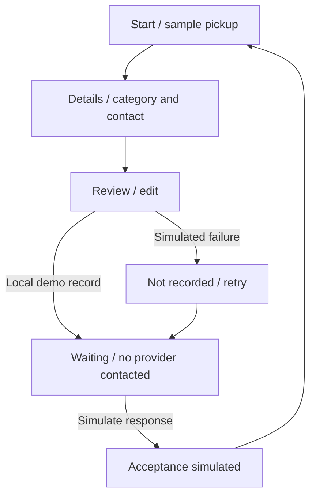

# Task 03 — Mobile app prototype design

**THE SAVIOUR / Patient** is a high fidelity, interactive mobile UI/UX prototype derived from the [Task 1 wireframes](https://www.figma.com/design/OoIJIHcTxCjIO37I3FHNom). Open `index.html`; no dependencies or setup are required.

**Safety boundary:** No request leaves the page. There is no location detection, hospital integration, dispatch, ambulance assignment, or ETA. Do not enter a real address or contact number. The `tel:112` link offers a real call path in India; this app is not an emergency service.

## User journey and screen map

Six states cover the full hypothesis journey: start, details, review, local waiting, simulated acceptance, and failure recovery. The failure path retains form information. The waiting and acceptance states explicitly distinguish browser-local actions from verified service activity.

## Design system and reusable patterns

| Element | Decision |
| --- | --- |
| Typography | System sans for fast loading and clear controls; strong size hierarchy. |
| Ink / canvas | `#102c3a` on white; calm information hierarchy. |
| Teal | `#087b78` for informative progress and simulated continuation. |
| Red | `#bd3938` for the main request action and explicit warning. |
| Controls | At least 48 px high with visible focus treatment. |
| Components | Shared header, step label, notices, primary/secondary actions, summary rows, timeline, footer call link. |
| Layout | Full-screen mobile experience; device presentation and explanatory panel on desktop. |

The visual concept prioritizes unambiguous copy and one main action per step. It avoids a fake live map or an invented ETA. A two-screen visual design reference was generated before implementation; the coded screens retain its palette, typography hierarchy, disclosure, and touch scale.

## Brief and evaluation checklist

| Requirement | Evidence |
| --- | --- |
| User flow diagram | Mermaid map above and six distinct states. |
| High fidelity screens | Responsive HTML/CSS screens from start through failure and simulated acceptance. |
| Interactive prototype | Form validation, editable details, review, two send outcomes, recovery, simulated response, restart. |
| Test navigation and interactions | Internal desktop and mobile walkthrough; see protocol below. |
| Refine experience | Meaningful no-delivery language, retained details on failure, clear call alternative, keyboard focus. |
| Code quality / responsiveness / UI / functionality | Dependency-free source, semantic labels and buttons, mobile layout, explicit state guards. |

## Verification protocol

1. Start from a sample pickup point, edit it, then enter a fictitious 10-digit number and select a category.
2. Review and edit details; verify that the updated values appear on review.
3. Simulate failure; verify that the text says nothing was sent, Call 112 is visible, and retry retains details.
4. Retry to the local waiting screen; simulate acceptance; verify that the screen never claims an actual hospital response or ETA.
5. Start over. Repeat on a 375 px screen and with keyboard navigation. Verify empty/invalid contact validation.

This is a prototype walkthrough, not a usability study with participants. Real user testing, screen reader testing, field validation, and integration review are required before production design decisions.

