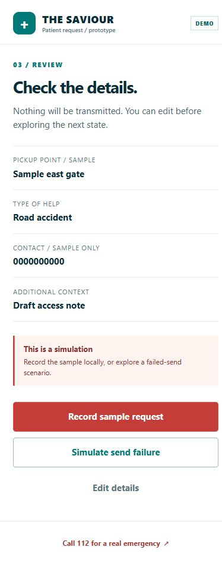

# Task 03 - Mobile app prototype

THE SAVIOUR explores a short patient request journey with review, clear status, and recoverable failures. This submission is a working design prototype with seven screens, not an emergency dispatch service.

[Live prototype](https://auspify-task-03.vercel.app/) | [Evaluation checklist](EVALUATION.md) | [Design rationale](DESIGN.md) | [User flow](user-flow.svg)



## Try the complete flow

1. Edit the sample pickup and start a sample request.
2. Choose a category, enter `0000000000`, and add an optional sample note.
3. Go back and return: the unfinished draft remains. Review and edit before recording.
4. Explore send failure and retry, local recording, no response and recovery, then simulated acceptance.
5. Start a new demo to clear the previous contact, category, and note.

Browser Back and Forward retain the draft. Refresh resets this in-memory demonstration. A direct status URL cannot manufacture a recorded request or provider response. The call link remains available on every screen; it was inspected without placing a call.

## Deliverables

| File | Purpose |
| --- | --- |
| `index.html`, `styles.css`, `app.js` | High-fidelity responsive screens and interactive prototype |
| `journey.js` | Draft, validation, and guarded demonstration state |
| `user-flow.svg` | Original, accessible flow diagram with alternate paths |
| `DESIGN.md` | Screen inventory, decisions, and refinement log |
| `EVALUATION.md` | All five Task 3 steps and seven PDF evaluation criteria |
| `tests/journey.test.cjs` | Seven state, validation, and escaping checks |
| `evidence/` | Twelve browser screenshots and 15 recorded browser checks |

## Run locally

Serve this folder with a static server. With Node.js installed:

```powershell
npx --yes http-server . -p 8765 -c-1
```

Open `http://localhost:8765/`. The prototype itself has no package dependencies or build step.

```powershell
node --test tests/journey.test.cjs
```

Validation on 16 November 2026: **7/7 automated checks and 15/15 internal browser checks passed**. Requested viewports: 320, 390, and 768 pixels, plus the desktop browser. These are internal design and implementation checks, not a participant usability study. See the checklist for scope and evidence.
