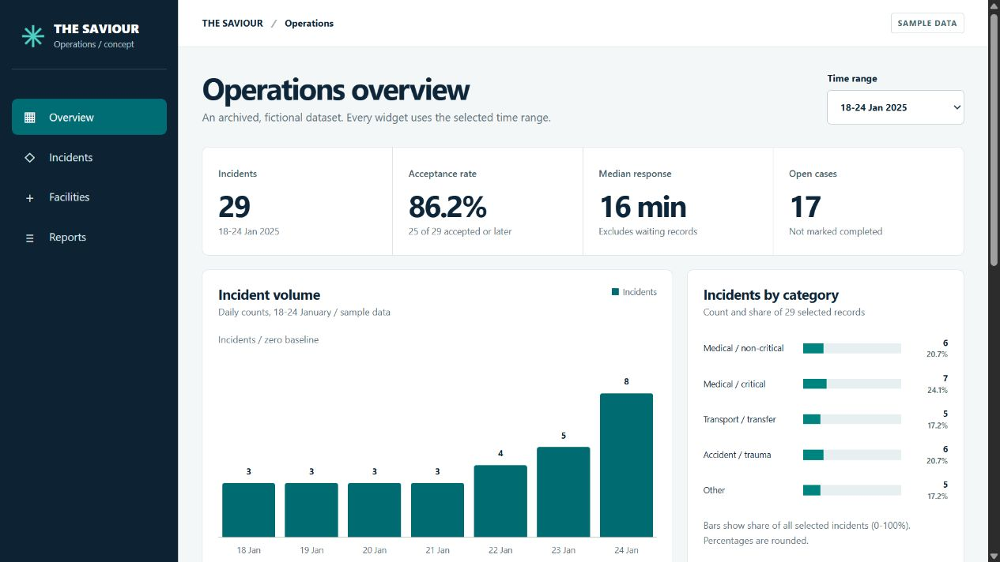

# Task 04 - Operations dashboard

THE SAVIOUR turns a fictional incident register into an overview, searchable records, facility assignments, and a filtered CSV export. All dates, counts, and charts derive from the same archived sample dataset.

[Live dashboard](https://auspify-task-04.vercel.app/) | [Evaluation checklist](EVALUATION.md) | [Research and definitions](RESEARCH.md)



## Review the workflow

1. Switch between the sample week and January. Cards, charts, recent records, and facility counts follow the selected range.
2. Open Incidents, search, filter by status, and use pagination. Open a record and return without losing the selection.
3. Open Facilities and inspect the records assigned to a facility.
4. Open Reports. The same range, search, and status apply. Download every matching row, including results on other pages.
5. Try an empty search, clear the filters, and test navigation on mobile using the menu and Escape.

The dataset contains 101 invented records across January 2025; 29 belong to 18-24 January. There are no live incidents, patient identities, or dispatch actions.

## Source and evidence

| File | Purpose |
| --- | --- |
| `index.html`, `styles.css`, `app.js` | Responsive clickable dashboard |
| `data.js` | Deterministic fixtures, shared selection, metrics, charts, and CSV logic |
| `RESEARCH.md` | Primary-source desk research, design inferences, metric definitions, refinements |
| `EVALUATION.md` | All five Task 4 steps and seven PDF evaluation criteria |
| `tests/data.test.cjs` | Nine data and export regression checks |
| `evidence/` | Twelve real browser screenshots, 21 browser checks, and the downloaded 11-row CSV |

## Run locally

Serve this folder with a static server. With Node.js installed:

```powershell
npx --yes http-server . -p 8766 -c-1
```

Open `http://localhost:8766/`. The application itself has no package dependencies or build step.

```powershell
node --test tests/data.test.cjs
```

Validation on 16 November 2026: **9/9 automated checks and 21/21 internal browser checks passed**. The actual downloaded CSV matched the 11 selected records. Desktop, tablet, and mobile layouts were inspected. These checks do not constitute a participant study or a full accessibility conformance audit.
