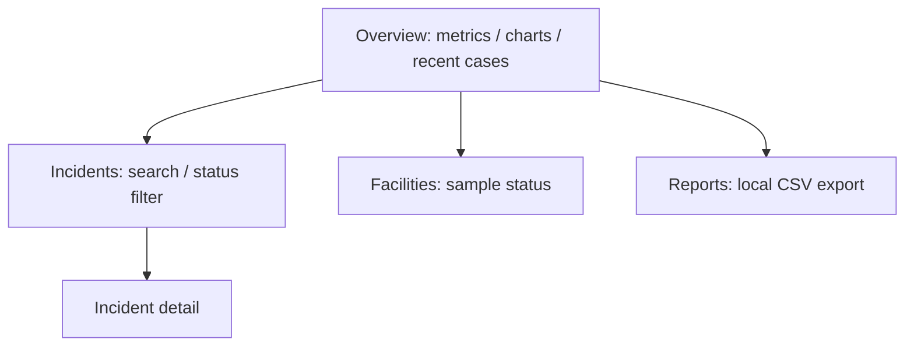

# Task 04 — Dashboard UI/UX design

**THE SAVIOUR / Operations** is an interactive dashboard design prototype. All incidents, metrics, facilities, dates, and status values are **fictional sample data**. It has no connection to real emergency systems and must not guide operational decisions.

Open `index.html` in a browser. No build, API key, database, or account is needed.

## Desk research

- [GOV.UK dashboard guidance](https://brand.design-system.service.gov.uk/data/dashboards/) describes dashboards as high-level indicator views and calls for careful hierarchy and concise explanation. This informed the summary-first layout and separate record detail.
- [W3C WAI table tutorial](https://www.w3.org/WAI/tutorials/tables/) explains why header relationships matter for accessible data tables. The register uses semantic column headers rather than a visual grid of divs.

These are design references, not competitor testing or research with dispatch staff. A real operational design requires participant interviews, verified data definitions, and institutional review.

## Workflow and design decisions

| Required step | Evidence |
| --- | --- |
| Research dashboard structures | A high-level overview answers *what changed?*; the register answers *which records need attention?*; detail views provide context; facilities and reports have separate navigation. This is a design rationale, not user research. |
| Design navigation menus and widgets | Persistent desktop sidebar, collapsible mobile navigation, range selector, summary metrics, status counts, search and status filters. |
| Create charts, cards and tables | Daily/weekly incident volume, category breakdown, four summary metrics, facility cards, searchable incident register, detail page. |
| Improve accessibility and usability | Semantic headings/table headers, descriptive chart text, visible focus indicators, keyboard buttons, responsive overflow for wide tables, explicit sample-data labels and empty state. |
| Build clickable prototype | Overview → incidents → detail → back; facilities and reports; filter, search, range change and local CSV export. |

### Information architecture

The chart and categories use a coherent illustrative weekly total of 428. The alternate month view uses a separate weekly series; its category panel explicitly keeps the example weekly breakdown. The eight incident rows are illustrative examples, not the full set behind the aggregate numbers.

## Evaluation criteria

| Criterion | Evidence and limitation |
| --- | --- |
| Task completion | All five workflow steps represented as a working concept. No formal participant research. |
| Code quality | Dependency-free HTML/CSS/JS, structured data arrays and distinct render functions; `node --check app.js` passes. |
| Responsiveness | Desktop sidebar, mobile menu, wrapping summary, stacked panels, scrollable table. Browser QA required. |
| Interface design | Consistent palette, type hierarchy, spacing, labelled controls, data disclosure. |
| Creativity and implementation | Operational clarity without pretending synthetic data is live; meaningful chart alternative text and local export. |
| Professional presentation | Source, rationale, information architecture, clear limitations and verification plan. |
| Functionality | Range change, navigation, filtering, search, record detail and CSV download operate entirely in-browser. |

## Verification plan

Check the desktop and 375 px mobile layout; switch time range and confirm metrics/charts update; open the incident register and search `INC-02584`; filter to Completed; open a detail record and navigate back; inspect facilities; download CSV and check that it contains eight fictional records. Check keyboard navigation and the chart's text alternative. This is an internal walkthrough; a usability study with participants has not been conducted.

For submission, include screenshots of desktop and mobile screens, the source folder and its branch link. The internship brief makes video optional.

