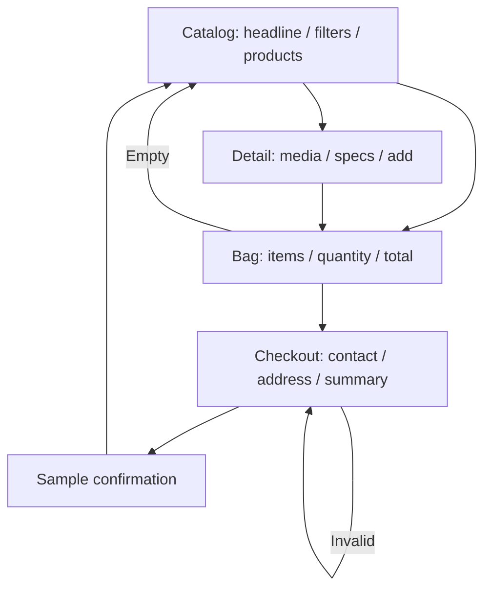

# Task 05 — E-commerce app UI/UX design

**Form & Field** is a fictional home objects store. Open `index.html` directly or serve this folder with `python -m http.server 8766`. The catalog, detail page, bag, checkout, and confirmation are interactive. Bag quantities persist in local browser storage; checkout does not transmit data or take payment.

## Design intent

The brief asks for an optimized shopping experience. The central question is: can a shopper find a suitable object, understand its details and total cost, adjust their bag, and finish a short checkout without uncertainty? The editorial visual system uses a restrained olive accent, warm paper canvas, serif display type, generous product imagery, and explicit controls. Product names, prices, materials, dimensions, and delivery terms are illustrative, not real inventory.

## Workflow evidence

| Brief step | Deliverable | Status |
| --- | --- | --- |
| 1. User journeys and wireframes | Journey and screen maps below | Conceptual; no participant research |
| 2. Listing and detail screens | Category filtering, price sorting, six products, dedicated detail views | Built |
| 3. Cart and checkout | Adjustable quantities, remove, subtotal, shipping, total, labelled address form, validation, sample confirmation | Built |
| 4. Interactive prototype | Responsive browser app with back navigation, local bag persistence, clear empty and error states | Built |
| 5. Usability testing | Internal task walkthrough and code checks below | Formal testing with participants pending |

### Hypothesis journey

1. **Discover:** Enter the shop, scan the assortment, filter by category or sort by price.
2. **Evaluate:** Open a product to inspect price, material, dimensions, and description.
3. **Decide:** Add to bag, revise quantities, or remove an item. See shipping and total before checkout.
4. **Complete:** Enter contact and delivery fields, see validation, then reach an unmistakably simulated confirmation.

This is a design hypothesis, not a measured user journey. A real study should recruit shoppers with varying device sizes and assistive technology needs.

### Low fidelity screen map

Wireframe content order: catalog header → category controls → product grid; detail image → name/price → description/specifications → add; bag line items → quantity/remove → cost summary; checkout form → cost summary → action. The final screens preserve that structure at mobile and desktop widths.

## Evaluation against internship criteria

| Criterion | Evidence and limitation |
| --- | --- |
| Task completion | All five workflow steps represented; participant testing remains outstanding. |
| Code quality | Plain HTML, CSS, and JavaScript with product data separated from render functions; no build dependencies. |
| Responsiveness | Three-to-two-to-one column behavior, fluid typography, stacked checkout and detail layouts; browser visual testing pending. |
| UI design | Consistent typography, color, spacing, image treatment, focus indicators, labels, and feedback. |
| Creativity and implementation | Deliberate editorial art direction with original vector product illustrations. |
| Professional presentation | Documented user path, wireframe order, visual rationale, and limitations. |
| Functionality | Filter, sort, detail, add, quantity, removal, total, form validation, confirmation, persistence. No real inventory, payment, fulfillment, or account. |

## Test protocol and outcomes

The JavaScript passes `node --check app.js`. An internal task walkthrough should cover: filter to Decor; sort low to high; open Glass Vase; add twice; decrease and remove in the bag; add Oak Side Table; complete checkout; leave required fields empty to trigger validation; complete valid fields; verify that the bag clears and the confirmation states no order was placed. Repeat at 375 px and 1280 px, with keyboard only and a screen reader. **No external participants have completed this protocol yet.** Do not present the concept as a validated commercial store.

## Submission

Source files are in this folder. Capture desktop and mobile screenshots after browser QA. A demo video is optional under the internship brief.

