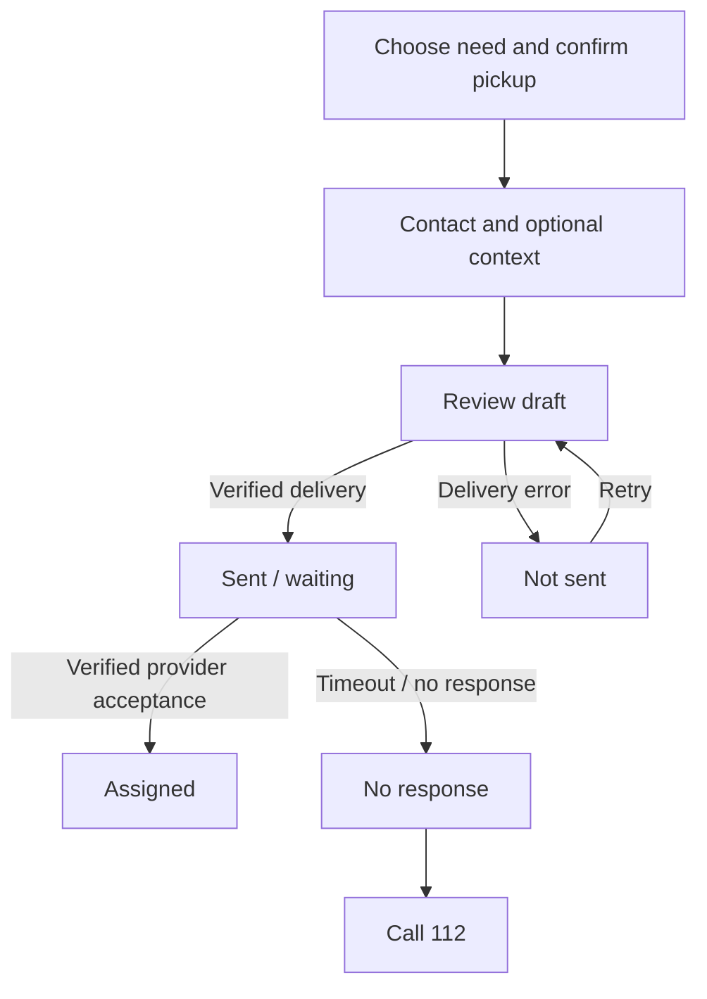

# Task 06 — Complete product design case study

**Product:** THE SAVIOUR  
**Scope:** Patient-facing emergency coordination concept for India  
**Deliverables:** Working local three-role demo, research, assumptions, user journey, low fidelity exploration, high fidelity screens, design system, and evaluation record

## Open the project

Open [index.html](index.html) for the working demo. Open [case-study.html](case-study.html) for the design process and the earlier patient screen prototype. No package install, API key, or account is needed. Use a local server for reliable multi-tab behavior:

```powershell
python -m http.server 8765 --directory "C:\Users\akith\AUSPIFY\task-06-product-case-study"
```

Then open `http://localhost:8765/`. Open the page in three tabs, choose a different role in each, and submit a **sample** request. The hospital can accept and dispatch it; traffic control can acknowledge the route; the patient sees those updates. State syncs across tabs in the same browser through local storage, not across devices.

Run both state test files with `node --test tests/flow.test.mjs tests/model.test.cjs`.

**This is not an emergency service.** The demo writes only to local browser storage. It never sends a request, reads live location, connects to a hospital, assigns a vehicle, or informs traffic police. Do not enter real emergency or personal information. For a real emergency in India, the interface provides a direct `tel:112` link.

## Problem and opportunity

The Ministry of Home Affairs already operates the 112 Emergency Response Support System, which handles multiple intake channels and dispatches to relevant services. The 112 India app describes location sharing and status tracking. The National Health Mission also describes the established 108/102 ambulance pathways. Therefore this case study does **not** claim a novel emergency network or guaranteed faster response. It explores whether clearer patient-facing delivery and handoff states could reduce uncertainty and prevent someone from mistaking an unsent request for an assigned ambulance.

| Source | What it supports | Design consequence |
| --- | --- | --- |
| [MHA ERSS](https://www.mha.gov.in/emergency-response-support-system-erss) | Unified 112 intake, dispatch, and resource coordination | Keep 112 visible; real integration requires permission and a verified service contract. |
| [112 India app listing](https://play.google.com/store/apps/details?id=in.cdac.ners.psa.mobile.android.national) | SOS, location, categories, and status features | These are existing capabilities; the concept focuses on handoff clarity. |
| [NHM ambulance service](https://nhm.gov.in/nhm_live/index1.php?lang=1&level=2&lid=189&sublinkid=1217) | 108 critical care and trauma; 102 mainly patient transport | Avoid implying a competing dispatch network. |
| [RapidSOS developer documentation](https://developer.rapidsos.com/public_safety/default/how-to-integrate-with-rapid-sos-portal) | US public safety data integration (adjacent comparison, not an Indian ambulance provider) | Rich incident handoffs depend on authorized service integrations. |

Research above is **secondary desk research** reviewed in November 2026. No interviews, field study, clinical evaluation, or competitor usability tests were performed.

## User model and journey

**Hypothesis persona 1 - bystander:** A person assisting a stranger after a road accident, using a phone under stress, possibly outdoors or on an unreliable connection. Their goals are to share the correct pickup point, provide a reachable number, and know whether the request was delivered.

**Hypothesis persona 2 - patient:** A person with an urgent medical problem who may have limited attention or dexterity. They need large controls, little typing, clear state labels, and a direct call option.

These are design hypotheses, not personas based on interview data. A hospital dispatcher is a future research participant, not a persona whose workflow this prototype claims to solve.



**Critical distinction:** In the case-study prototype, "Not sent" means no delivery confirmation, "Sent / waiting" means delivery acknowledged but no provider accepted, and "Assigned" requires verified acceptance. The main three-role demo uses a different, explicitly local state model: created → hospital accepted → ambulance marked en route → traffic acknowledged → arrived. Its labels describe actions in this browser, never actual service delivery.

The patient journey emphasizes fewer fields and a call alternative. The bystander journey emphasizes an editable pickup location and contact number. Both converge at review and the same explicit handoff states.

The [Task 1 wireframes](https://www.figma.com/design/OoIJIHcTxCjIO37I3FHNom) are the low fidelity starting point. Task 6 refines the state model, responsive visual language, and interactive behavior.

## Design system

| Token | Value | Use |
| --- | --- | --- |
| Ink | `#102C3A` | Main text and structure |
| Action | `#C63F3F` | Primary request action |
| Signal | `#087B78` | Selection, links, informative status |
| Canvas | `#F7F9F9` | Case study background |
| Type | DM Sans / system sans | Clear compact UI and headings |
| Spacing | 8 px rhythm | Consistent grouping |
| Controls | Minimum 48 px | Touch use and visible keyboard focus |

The phone UI uses semantic buttons, labelled fields, status text, and a persistent emergency call link. Color is supplementary to the written state. Form data remains in memory for the page session and is escaped before display.

## Evaluation and limits

| Evaluation criterion | Evidence in this branch | Result |
| --- | --- | --- |
| Task completion | Research, assumptions, journey, wireframes link, responsive high fidelity app, three-role demo, case study | Complete as a design concept and local working model |
| Code quality | Separate demo model and UI, HTML/CSS/JS; escaped user text; no runtime dependencies | State tests pass; peer review pending |
| Website responsiveness | Desktop layout, tablet breakpoint, narrow phone layout | CSS implemented; browser visual QA pending |
| User interface design | Type scale, color tokens, spacing, states, focus style, tap targets | Design review complete; real usability untested |
| Creativity and implementation | Visible patient–hospital–traffic handoff and distinct failed-send/no-response concepts | Multi-role demo works locally; no real integration |
| Professional presentation | Case study narrative, sources, constraints, linked wireframes | Complete |
| Project functionality | Submit, accept, dispatch, route acknowledgement, arrival, clear, and same-browser tab sync; separate patient prototype covers send failure | State tests pass; no backend integration |
| Submission process | Source files, branch link, screenshots, optional video | Source and branch available; screenshots/video pending |

### Next validation before a real service

- Run observed usability sessions with patients, bystanders, older adults, and assistive technology users.
- Test screen readers, small devices, offline conditions, intermittent delivery, and delayed provider responses.
- Define delivery acknowledgements, timeout escalation, duplicate request handling, and safe retry semantics with actual dispatch partners.
- Review consent, security, privacy, data retention, and institutional authorization.
- Replace all sample hospital, vehicle, and ETA content with verified response data. Build authenticated roles and an authorized backend before any real use.

**Outcome:** A working, reviewable UI concept and a documented research-informed design hypothesis. It does not establish improved response times or real emergency outcomes.

